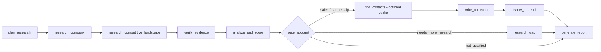

# Prospecting Agent v2 (LangGraph + LangChain + LangSmith)

An AI agent that does an SDR's research, and, more importantly, **decides whether an account is likely to
need and buy LangSmith, not just whether it uses AI.**

Built by Eliott Bonnet, SDR, to show how I'd use agents to prospect smarter, using LangChain's own stack.

## The problem it solves

v1 scored Mistral AI 4/5 and drafted a sales email: Mistral builds LLMs, ships agents and hires AI engineers.
All true, but that is *technical relevance*, not buying intent. Mistral also ships its own tracing and
evaluation (Studio) and documents a LangChain integration, so it looks more like a **partner** than a buyer.
v1 also trusted dates and claims from unreliable pages. v2 fixes both. (See `v1/` and `examples/` for the original, kept as a baseline.)

## Workflow



- **research_competitive_landscape** deliberately looks for reasons *not* to sell: internal tooling, tools already in use, integrations.
- **verify_evidence** extracts claims, each with a verbatim excerpt and URL. **Plain code** then checks the URL was really retrieved and the excerpt really appears in the retrieved text (`verification.py`). Unsupported claims are never used. An event date is kept only if the excerpt states it; a search snippet's publication date is never treated as a launch date.
- **analyze_and_score**: the LLM only interprets *verified* claims. Scores and classification come from explicit rules (`scoring.py`).
- **route_account** has four outcomes: `sales_opportunity`, `partnership_opportunity`, `needs_more_research`, `not_qualified`. Outreach is written only for the first two (partnership gets an ecosystem message, not a pitch).
- **review_outreach** checks the draft in code (length, CTA, signature, hype phrases, every number traceable to a cited verified claim, only verified claims cited) and allows **one** targeted revision. If it still fails, the report says so.
- The report separates **verified facts** from **hypotheses to validate** (each with counter-evidence and a discovery question).

## Scoring rules (configurable in `scoring.py`)

| Output | Rule |
|---|---|
| Technical fit 1-5 | starts at 1; +1 each for verified agentic AI, production use, AI hiring, LLM/model builder, and 6+ such signals |
| Buyer fit 1-5 | starts **neutral at 3** (missing info is not negative); +1 stated unmet need; -1 internal tooling; -1 already uses a third-party tool |
| Evidence confidence | high: 6+ verified claims incl. competitive evidence; medium: 3+; else low |
| Build-vs-buy risk | unknown (nothing found) / high (internal tooling) / medium (other tool or model provider) / low |
| Classification | none verified or low confidence -> needs_more_research; weak technical fit -> not_qualified; integration or model provider + (weak buyer, high risk, or no stated need) -> partnership; buyer fit >= 3 and risk not high -> sales |

Batch results are sorted by commercial priority (classification, buyer fit, confidence), not by technical fit.

## Run it

```bash
python -m venv .venv && source .venv/bin/activate     # Python 3.10+
pip install -r requirements.txt
cp .env.example .env        # add ANTHROPIC_API_KEY (and LANGSMITH_API_KEY)

python agent.py "Mistral AI"              # one account -> output/Mistral_AI.md
python agent.py --file companies.txt      # batch -> output/results.csv
```

Without LangSmith keys the agent still works and prints a warning.

## LangSmith

Set `LANGSMITH_TRACING=true` and `LANGSMITH_API_KEY` in `.env`. Each run is named `prospect: <company>`, tagged with
the workflow version, and carries metadata (model, prompt version, final classification, scores). In
*Tracing Projects > prospecting-agent* you see every search, LLM call, verification and routing decision.

## Tests and evaluations

```bash
python -m unittest discover -s tests -t .     # 27 offline tests, no API key (incl. a Mistral regression)
python evals/run_eval.py                      # rules vs 8 labelled SYNTHETIC scenarios
python evals/run_eval.py --langsmith          # same, logged as a LangSmith experiment
python evals/compare_v1_v2.py "Mistral AI"    # live V1 vs V2 on the same company (uses API credits)
```

The synthetic dataset tests the scoring/routing rules, not live research. It is small and I adjusted two rules
after the first run exposed mismatches (6/8 -> 8/8), so treat it as a regression suite, not a performance claim.
Live result on Mistral AI (one run, search results vary): v1 = 4/5 with a sales email; v2 = technical 4, buyer 2,
build-vs-buy high, `partnership_opportunity`.

## Optional Lusha enrichment

With `LUSHA_API_KEY`, accounts routed to sales/partnership get up to 3 senior contacts (name, title, LinkedIn;
decision makers first, interns excluded; partnership accounts also try partnership/developer-relations titles).
It never guesses: no match means no name. Emails and phones are never revealed.

## Known limitations

- **"Verified" means faithful to the retrieved source, not independently true.** A claim copied from a weak blog or job aggregator still counts as verified; the sources table shows each source's type (official / job_board / third_party), so prefer official ones before quoting a fact.
- Evidence comes from search snippets, not full pages, and from free DuckDuckGo unless `TAVILY_API_KEY` is set.
- Claim categories are assigned by the LLM, so a mislabelled claim can shift a score; the report shows every claim and its category so a human can check.
- Outreach is only a draft: review it before sending. Nothing is sent automatically.
- Not built yet: human approval step (LangGraph interrupt), cost tracking beyond LangSmith's own token view, a larger human-labelled dataset.
